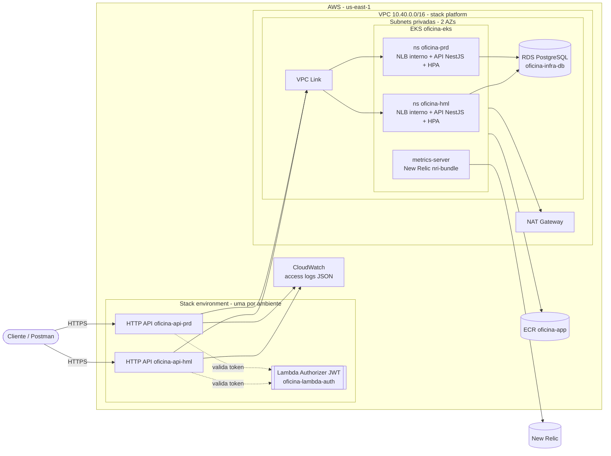

# oficina-infra-k8s

Infraestrutura como código (Terraform) da plataforma Kubernetes da **Oficina Mecânica**, projeto do Tech Challenge da Pós-Tech em Arquitetura de Software (FIAP), fase 3.

Este repositório provisiona na AWS a rede, o cluster **Amazon EKS**, o registro de imagens **ECR**, os add-ons do cluster (Metrics Server para o HPA e integração **New Relic** Kubernetes) e o **API Gateway** (HTTP API) de cada ambiente, que recebe todo o tráfego externo e o encaminha para a API no cluster.

| Repositório | Responsabilidade |
| --- | --- |
| [tech-challenge](https://github.com/Guribeiro/tech-challenge) | Aplicação NestJS executada no EKS (manifests Kustomize e deploy) |
| **oficina-infra-k8s** (este) | VPC, EKS, ECR, add-ons do cluster e API Gateway |
| oficina-infra-db | Amazon RDS PostgreSQL e segredos no Secrets Manager |
| oficina-lambda-auth | Lambdas de autenticação por CPF e authorizer JWT |

## Tecnologias

- Terraform 1.13 (backend S3 com lock nativo)
- AWS: VPC, NAT Gateway, EKS 1.33, ECR, API Gateway HTTP API, VPC Link, CloudWatch Logs
- Helm: Metrics Server e New Relic `nri-bundle`
- Provider `newrelic`: dashboards, alertas e monitor Synthetics por ambiente
- GitHub Actions (fmt, validate, tflint, plan e apply por ambiente)

## Arquitetura



### Stacks

| Stack | State | Aplicada por | Conteúdo |
| --- | --- | --- | --- |
| `stacks/platform` | `oficina-infra-k8s/platform/terraform.tfstate` | push na `main` | VPC (2 AZs, 1 NAT), EKS + node group (t3.medium, 2–4 nós), add-ons, ECR, VPC Link |
| `stacks/environment` | `oficina-infra-k8s/environment/<env>/terraform.tfstate` | push na `develop` (hml) e na `main` (prd) | HTTP API do ambiente, stage `$default` com throttling e access log, integração privada com o NLB da app, authorizer, rotas e observabilidade no New Relic |

A plataforma é compartilhada pelos dois ambientes (um único cluster com namespaces `oficina-hml` e `oficina-prd`) para caber no orçamento do AWS Learner Lab; por isso ela só é alterada a partir da `main`, após revisão.

### Rotas do API Gateway

| Rota | Autorização |
| --- | --- |
| `POST /auth/cpf` | Pública (criada pelo repositório `oficina-lambda-auth`) |
| `POST /api/sessions/sign-in`, `GET /api/health`, `GET /api/ordens-servicos/rastreio`, `POST /api/webhooks/pagamentos`, `GET /docs` | Pública |
| `ANY /api/{proxy+}` | Lambda Authorizer (JWT de cliente ou funcionário) |

O gateway encaminha o `requestId` como cabeçalho `x-request-id`, que a API grava em todos os logs JSON, permitindo correlacionar o access log do gateway com os logs e traces da aplicação no New Relic.

### Ordem de provisionamento

A stack `environment` tolera a ordem de entrega dos outros repositórios: se o NLB da aplicação ou a função authorizer ainda não existirem, os recursos dependentes não são criados e o apply conclui normalmente. Basta reaplicar depois.

1. `bootstrap/state.sh`: bucket do Terraform state (uma vez por conta).
   Em seguida, `SET_STATE_BUCKET=true bootstrap/github-secrets.sh` cria os GitHub Environments dos 4 repositórios, copia para eles as credenciais do Learner Lab e grava `TF_STATE_BUCKET`. A cada nova sessão do lab, rode o script de novo (sem `SET_STATE_BUCKET`).
2. Stack `platform`: rede, EKS, ECR, VPC Link.
3. `oficina-infra-db`: RDS e segredos.
4. Deploy da aplicação (`tech-challenge`): cria o NLB interno de cada ambiente.
5. `oficina-lambda-auth`: funções de autenticação e rota `/auth/cpf`.
6. Stack `environment` novamente (ou `workflow_dispatch`): integração com o NLB e authorizer.

## Observabilidade (New Relic)

O módulo [`modules/observability`](modules/observability) cria, para cada ambiente, os recursos abaixo. Ele só é aplicado quando `newrelic_account_id` e `newrelic_api_key` estão definidos; sem eles, a stack funciona normalmente sem nada no New Relic.

| Recurso | Conteúdo |
| --- | --- |
| Dashboard **Operacional** | Página *API*: throughput, taxa de erro, latência p50/p95/p99 geral e por rota, erros por classe, disponibilidade. Página *Kubernetes*: CPU e memória por pod, réplicas do HPA, CPU/memória dos nós, reinícios, estado dos pods. Página *Autenticação*: invocações, duração p95 e erros das Lambdas, duração do health check |
| Dashboard **Negócio** | OS recebidas e entregues no dia, volume diário de OS, tempo médio em cada status (diagnóstico, execução, finalização), transições por hora, falhas de integração e erros das Lambdas |
| Monitor Synthetics | Ping a cada 15 min em `<invoke_url>/api/health` (gateway → NLB → pods → banco), de `US_EAST_1` e `SA_EAST_1`; criado depois que a app está integrada ao gateway |
| Política de alertas | Taxa de erro > 5%, p95 > 1 s, CPU de pod > 80% do limit, reinício de container, falha de integração, erro em rotas de OS/orçamentos, erro nas Lambdas, health check falhando |
| Workflow de e-mail | Envia os incidentes da política para `alert_email` (opcional) |

Fontes dos dados: agente APM da API (`appName` `oficina-app-<env>`, eventos `OrdemServicoStatusAlterada` e `IntegracaoFalhou`), `nri-bundle` da stack platform (amostras `K8s*`) e a layer do New Relic nas Lambdas (`AwsLambdaInvocation`). Os limites dos alertas são variáveis do módulo.

## Pré-requisitos

- Conta AWS Learner Lab ativa (as roles `LabEksClusterRole` e `LabEksNodeRole` são reutilizadas, inclusive quando o lab as cria com prefixo/sufixo aleatório; nenhuma role IAM é criada)
- Terraform >= 1.10, AWS CLI v2, kubectl
- License key de ingestão do New Relic (opcional; sem ela a integração Kubernetes não é instalada)
- Account ID e User API key (`NRAK-...`) do New Relic (opcionais; sem eles dashboards e alertas não são criados)

## Execução local

```bash
# Credenciais da sessão do Learner Lab
aws sts get-caller-identity

# 1. Bucket do state (uma vez)
./bootstrap/state.sh
export TF_STATE_BUCKET=oficina-tfstate-<account_id>

# 2. Plataforma
export TF_VAR_newrelic_license_key=<license-key>   # opcional
./scripts/tf.sh platform plan
./scripts/tf.sh platform apply

# 3. Ambiente (dashboards e alertas: opcional)
export TF_VAR_newrelic_account_id=<account-id> TF_VAR_newrelic_api_key=<NRAK-...> TF_VAR_alert_email=<email>
./scripts/tf.sh environment hml apply
./scripts/tf.sh environment hml output   # invoke_url do API Gateway e links dos dashboards

# Acesso ao cluster
aws eks update-kubeconfig --name oficina-eks --region us-east-1
kubectl get nodes
```


## Ciclo de vida no Learner Lab (bringup e teardown)

Encerrar a sessão do Learner Lab **só para as instâncias EC2** (os nodes). EKS, NAT Gateway, NLBs, RDS e API Gateway continuam ativos e consomem o orçamento (cerca de US$ 5 a 7 por dia com os dois ambientes). Ao fim de cada período de trabalho, destrua a infraestrutura e recrie na próxima sessão:

```bash
# Fim da sessão: destrói hml, prd e a plataforma (pede confirmação digitando "destruir")
./scripts/teardown.sh

# Nova sessão: atualizar ~/.aws/credentials [learnerlab] com as credenciais do lab e então
./scripts/bringup.sh                 # ~40 min: plataforma + hml + prd + smoke test
./bootstrap/github-secrets.sh        # credenciais novas nos GitHub Environments
```

Os scripts orquestram os 4 repositórios, que precisam estar clonados lado a lado (`oficina-infra-k8s`, `oficina-infra-db`, `oficina-lambda-auth`, `tech-challenge`), e reaproveitam o `scripts/tf.sh` de cada um e o `scripts/deploy.sh` da aplicação. As credenciais do New Relic são lidas de `~/.newrelic.env` (opcional). Sem Terraform, jq, Node.js ou kubectl instalados, os passos rodam na imagem `tools/Dockerfile` (é preciso Docker, que também faz o build da imagem da aplicação).

| Script | Ordem |
| --- | --- |
| `teardown.sh` | por ambiente: Lambdas → environment → namespace `oficina-<env>` (remove o NLB criado pelo Kubernetes, que impediria apagar a VPC) → banco; por fim `platform` |
| `bringup.sh` | `platform` → imagem no ECR → por ambiente: banco → deploy da app (migrations e seed) → environment → Lambdas → environment (authorizer) → smoke test |

| Variável | Efeito |
| --- | --- |
| `ENVS=hml` / `ENVS=prd` | atua em um ambiente; no teardown a plataforma é mantida |
| `KEEP_PLATFORM=1` | teardown sem destruir a plataforma |
| `SEED=false` | bringup sem popular os bancos (padrão `true`) |
| `YES=1` | teardown sem confirmação interativa |
| `AWS_PROFILE` | perfil da sessão do lab (padrão `learnerlab`) |

Os dois scripts são idempotentes: se algo falhar no meio (ex.: credenciais expiradas), corrija e rode de novo. O bucket do Terraform state e as configurações do GitHub são mantidos. Os dados dos bancos não têm snapshot e são recriados pelo seed.

## CI/CD

Workflow [`.github/workflows/terraform.yml`](.github/workflows/terraform.yml):

| Evento | Execução |
| --- | --- |
| Pull request para `develop` ou `main` | `validate` (fmt, validate, tflint) e `plan` de `platform` + `environment` (hml ou prd) |
| Push na `develop` | apply `environment` hml |
| Push na `main` | apply `platform` e depois `environment` prd |
| `workflow_dispatch` | plan, apply ou destroy de qualquer stack/ambiente |

A `main` é protegida: alterações entram somente por pull request com o check `validate` aprovado.

### Configuração do GitHub

GitHub Environments `homologacao` e `producao`, cada um com:

| Tipo | Nome | Descrição |
| --- | --- | --- |
| Secret | `AWS_ACCESS_KEY_ID`, `AWS_SECRET_ACCESS_KEY`, `AWS_SESSION_TOKEN` | Credenciais temporárias do Learner Lab (atualizar a cada sessão) |
| Secret | `NEW_RELIC_LICENSE_KEY` | License key de ingestão do New Relic |
| Secret | `NEW_RELIC_API_KEY` | User API key (`NRAK-...`) usada pelo provider Terraform para dashboards e alertas |
| Variable | `NEW_RELIC_ACCOUNT_ID` | Account ID do New Relic |
| Variable | `ALERT_EMAIL` | Opcional: destino das notificações de alerta |
| Variable (repositório) | `TF_STATE_BUCKET` | Bucket criado pelo `bootstrap/state.sh` |
| Variable (repositório) | `AWS_REGION` | Opcional, padrão `us-east-1` |

## Outputs consumidos por outros repositórios

| Stack | Output | Consumidor |
| --- | --- | --- |
| platform | `vpc_id`, `vpc_cidr`, `private_subnet_ids`, `cluster_security_group_id` | oficina-infra-db, oficina-lambda-auth |
| platform | `cluster_name`, `ecr_repository_url` | tech-challenge (deploy) |
| environment | `api_id`, `api_execution_arn`, `invoke_url` | oficina-lambda-auth |

## Links

- Swagger da API (por ambiente): `<invoke_url>/docs`
- Aplicação e documentação arquitetural: [Guribeiro/tech-challenge](https://github.com/Guribeiro/tech-challenge)
