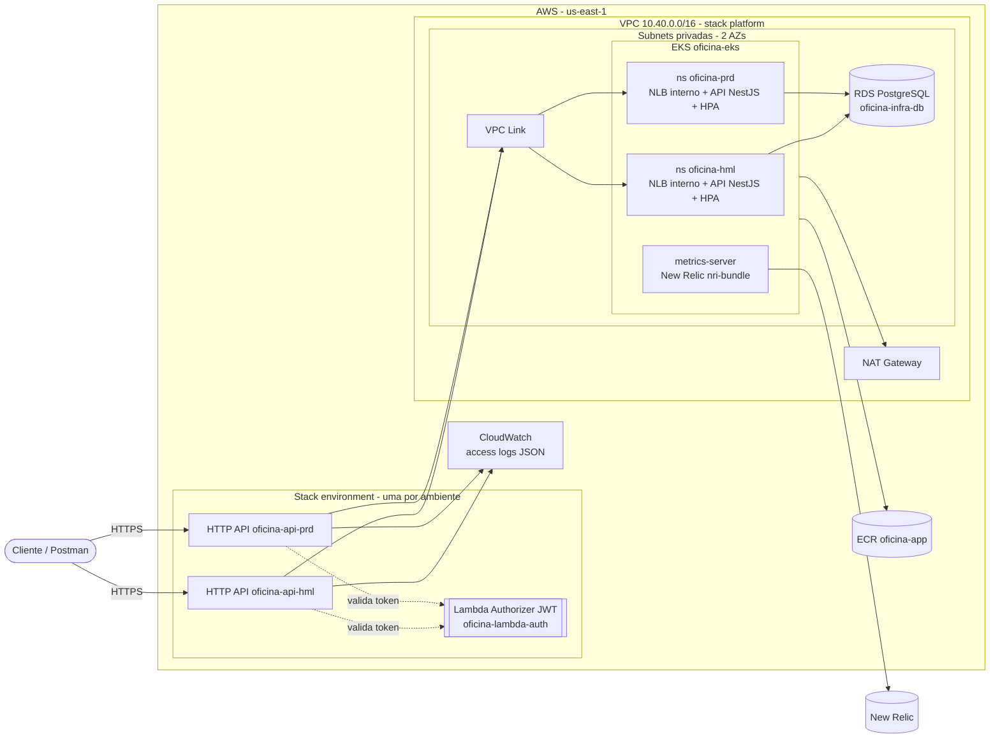

# oficina-infra-k8s

Infraestrutura como código (Terraform) da plataforma Kubernetes da **Oficina Mecânica**, projeto do Tech Challenge da Pós-Tech em Arquitetura de Software (FIAP), fase 3.

Este repositório provisiona na AWS a rede, o cluster **Amazon EKS**, o registro de imagens **ECR**, os add-ons do cluster (Metrics Server para o HPA e integração **New Relic** Kubernetes) e o **API Gateway** (HTTP API) de cada ambiente, que recebe todo o tráfego externo e o encaminha para a API no cluster.

| Repositório | Responsabilidade |
| --- | --- |
| [tech-challenge](https://github.com/Guribeiro/tech-challenge) | Aplicação NestJS executada no EKS (manifests Kustomize e deploy) |
| **oficina-infra-k8s** (este) | VPC, EKS, ECR, add-ons do cluster e API Gateway |
| oficina-infra-db | Amazon RDS PostgreSQL e segredos no Secrets Manager |
| oficina-lambda-auth | Lambdas de autenticação por CPF e authorizer JWT |

## Tecnologias

- Terraform 1.13 (backend S3 com lock nativo)
- AWS: VPC, NAT Gateway, EKS 1.33, ECR, API Gateway HTTP API, VPC Link, CloudWatch Logs
- Helm: Metrics Server e New Relic `nri-bundle`
- GitHub Actions (fmt, validate, tflint, plan e apply por ambiente)

## Arquitetura



### Stacks

| Stack | State | Aplicada por | Conteúdo |
| --- | --- | --- | --- |
| `stacks/platform` | `oficina-infra-k8s/platform/terraform.tfstate` | push na `main` | VPC (2 AZs, 1 NAT), EKS + node group (t3.medium, 2–4 nós), add-ons, ECR, VPC Link |
| `stacks/environment` | `oficina-infra-k8s/environment/<env>/terraform.tfstate` | push na `develop` (hml) e na `main` (prd) | HTTP API do ambiente, stage `$default` com throttling e access log, integração privada com o NLB da app, authorizer e rotas |

A plataforma é compartilhada pelos dois ambientes (um único cluster com namespaces `oficina-hml` e `oficina-prd`) para caber no orçamento do AWS Learner Lab; por isso ela só é alterada a partir da `main`, após revisão.

### Rotas do API Gateway

| Rota | Autorização |
| --- | --- |
| `POST /auth/cpf` | Pública (criada pelo repositório `oficina-lambda-auth`) |
| `POST /api/sessions/sign-in`, `GET /api/health`, `GET /api/ordens-servicos/rastreio`, `POST /api/webhooks/pagamentos`, `GET /docs` | Pública |
| `ANY /api/{proxy+}` | Lambda Authorizer (JWT de cliente ou funcionário) |

O gateway encaminha o `requestId` como cabeçalho `x-request-id`, que a API grava em todos os logs JSON, permitindo correlacionar o access log do gateway com os logs e traces da aplicação no New Relic.

### Ordem de provisionamento

A stack `environment` tolera a ordem de entrega dos outros repositórios: se o NLB da aplicação ou a função authorizer ainda não existirem, os recursos dependentes não são criados e o apply conclui normalmente. Basta reaplicar depois.

1. `bootstrap/state.sh`: bucket do Terraform state (uma vez por conta).
2. Stack `platform`: rede, EKS, ECR, VPC Link.
3. `oficina-infra-db`: RDS e segredos.
4. Deploy da aplicação (`tech-challenge`): cria o NLB interno de cada ambiente.
5. `oficina-lambda-auth`: funções de autenticação e rota `/auth/cpf`.
6. Stack `environment` novamente (ou `workflow_dispatch`): integração com o NLB e authorizer.

## Pré-requisitos

- Conta AWS Learner Lab ativa (as roles `LabEksClusterRole` e `LabEksNodeRole` são reutilizadas; nenhuma role IAM é criada)
- Terraform >= 1.10, AWS CLI v2, kubectl
- License key de ingestão do New Relic (opcional; sem ela a integração Kubernetes não é instalada)

## Execução local

```bash
# Credenciais da sessão do Learner Lab
aws sts get-caller-identity

# 1. Bucket do state (uma vez)
./bootstrap/state.sh
export TF_STATE_BUCKET=oficina-tfstate-<account_id>

# 2. Plataforma
export TF_VAR_newrelic_license_key=<license-key>   # opcional
./scripts/tf.sh platform plan
./scripts/tf.sh platform apply

# 3. Ambiente
./scripts/tf.sh environment hml apply
./scripts/tf.sh environment hml output   # invoke_url do API Gateway

# Acesso ao cluster
aws eks update-kubeconfig --name oficina-eks --region us-east-1
kubectl get nodes
```

Para evitar consumo do orçamento do laboratório entre as sessões de trabalho, destrua na ordem inversa: `./scripts/tf.sh environment <env> destroy` e depois `./scripts/tf.sh platform destroy` (ou pelo `workflow_dispatch`).

## CI/CD

Workflow [`.github/workflows/terraform.yml`](.github/workflows/terraform.yml):

| Evento | Execução |
| --- | --- |
| Pull request para `develop` ou `main` | `validate` (fmt, validate, tflint) e `plan` de `platform` + `environment` (hml ou prd) |
| Push na `develop` | apply `environment` hml |
| Push na `main` | apply `platform` e depois `environment` prd |
| `workflow_dispatch` | plan, apply ou destroy de qualquer stack/ambiente |

A `main` é protegida: alterações entram somente por pull request com o check `validate` aprovado.

### Configuração do GitHub

GitHub Environments `homologacao` e `producao`, cada um com:

| Tipo | Nome | Descrição |
| --- | --- | --- |
| Secret | `AWS_ACCESS_KEY_ID`, `AWS_SECRET_ACCESS_KEY`, `AWS_SESSION_TOKEN` | Credenciais temporárias do Learner Lab (atualizar a cada sessão) |
| Secret | `NEW_RELIC_LICENSE_KEY` | License key de ingestão do New Relic |
| Variable (repositório) | `TF_STATE_BUCKET` | Bucket criado pelo `bootstrap/state.sh` |
| Variable (repositório) | `AWS_REGION` | Opcional, padrão `us-east-1` |

## Outputs consumidos por outros repositórios

| Stack | Output | Consumidor |
| --- | --- | --- |
| platform | `vpc_id`, `vpc_cidr`, `private_subnet_ids`, `cluster_security_group_id` | oficina-infra-db, oficina-lambda-auth |
| platform | `cluster_name`, `ecr_repository_url` | tech-challenge (deploy) |
| environment | `api_id`, `api_execution_arn`, `invoke_url` | oficina-lambda-auth |

## Links

- Swagger da API (por ambiente): `<invoke_url>/docs`
- Aplicação e documentação arquitetural: [Guribeiro/tech-challenge](https://github.com/Guribeiro/tech-challenge)
